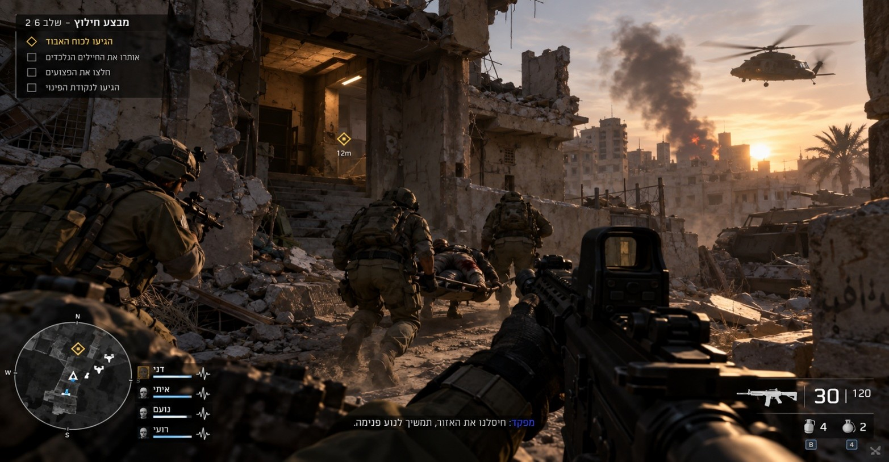
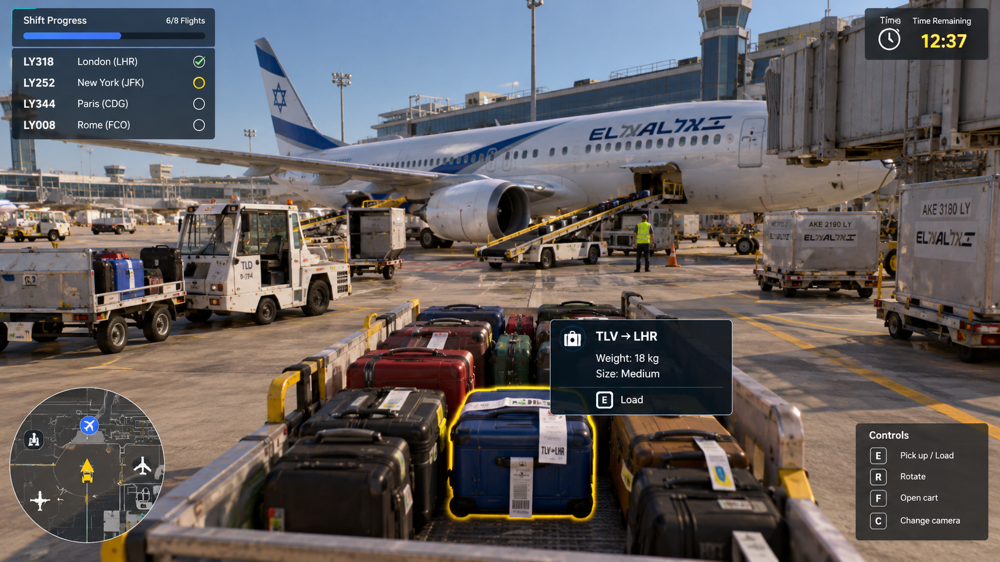
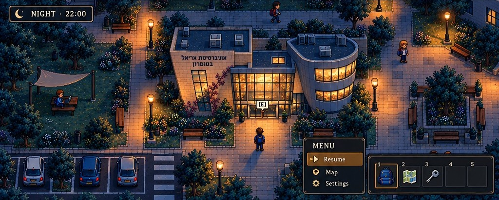
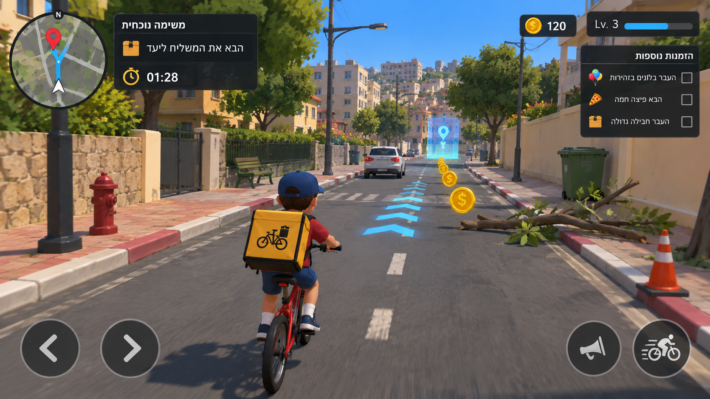
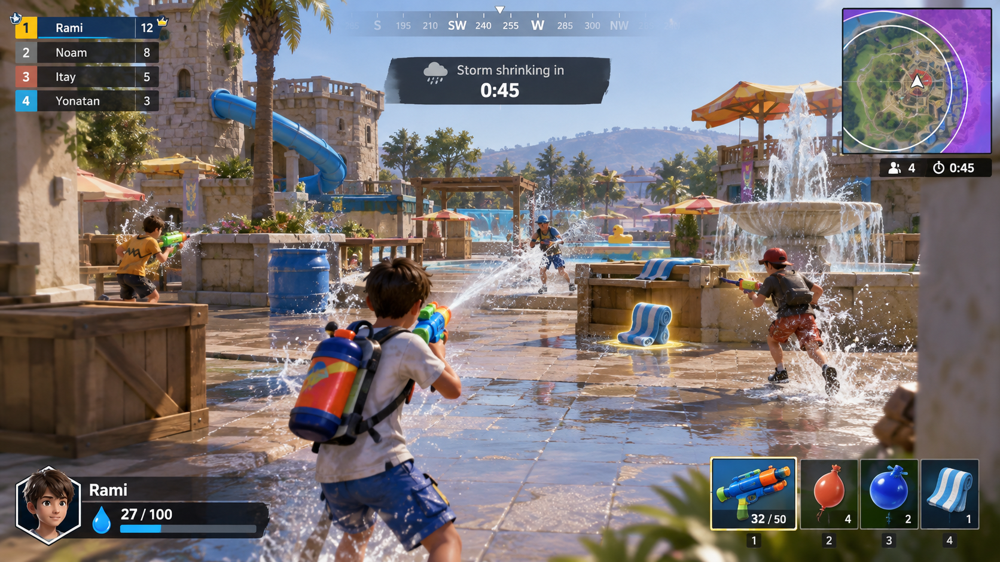

רמי פדול

# פיתוח משחקי מחשב – מטלה 1

<h2 dir="rtl">חלק א:</h2>

<h2 dir="rtl">שאלה 1:</h2>

<h3 dir="rtl">1.</h3>

אחי הגדול שירת בפיקוד העורף והשתתף במשימות חילוץ והצלה בעזה בזמן המלחמה.

בהשראת השירות שלו חשבתי על משחק שבו השחקן הוא לוחם בצוות חילוץ שנשלח עם הצוות שלו להציל כוח צבאי שנלכד בתוך שטח עוין.

בתחילת המשחק מתקבל דיווח על כוח שאיבד קשר עם הבסיס לאחר היתקלות עם מחבלים. השחקן והצוות שלו נשלחים לאתר את החיילים ולהחזיר אותם בשלום. בדרך הם עוברים בין מבנים הרוסים, נתקלים במחבלים ומתמודדים עם מכשולים שונים.

במהלך המשחק השחקן יכול להשתמש בנשקים שונים, לאסוף תחמושת וציוד רפואי.

באחת המשימות הצוות נתקל במחבלים, והשחקן צריך להגן על חבריו בזמן שהם מחלצים חייל פצוע מתוך מבנה.

אחרי שמוצאים את החיילים האבודים, צריך להוביל את כולם לנקודת הפינוי בזמן שהאויבים מנסים לעצור אותם. ככל שמתקדמים, הקרבות הופכים לקשים יותר, המשאבים מצטמצמים והשחקן צריך לקבל החלטות שיכולות להשפיע על גורל חברי הצוות.

המטרה המרכזית היא להשלים את מבצע החילוץ, להגיע לנקודת הפינוי ולחזור עם כמה שיותר חיילים בחיים. המשחק משלב אקשן, עבודת צוות, הישרדות וקבלת החלטות תחת לחץ.

<h3 dir="rtl">2.</h3>

חבר שלי עובד בנתב"ג במחלקת המזוודות. בעקבות העבודה שלו חשבתי על משחק שבו השחקן הוא עובד שאחראי על העברת מזוודות למטוסים לפני ההמראה.

המשחק מתחיל במשמרת רגילה בשדה התעופה, אבל פתאום מתרחשת תקלה במערכת והמזוודות מתחילות להגיע למקומות הלא נכונים.

במקביל, המטוסים ממשיכים להתכונן להמראה, והשחקן צריך לדאוג שכל מזוודה תגיע לטיסה המתאימה לפני שהיא יוצאת.

במהלך המשחק השחקן צריך לזהות לאיזו טיסה שייכת כל מזוודה, לסדר את המזוודות על רכב ולהוביל אותן למטוסים. בנוסף, צריך להתחשב במשקל ובגודל המזוודות כדי לסדר אותן נכון בעגלות ולמנוע מהן ליפול במהלך הנסיעה.

לכל משימה יש זמן מסוים שצריך לעמוד בו, וככל שמתקדמים במשחק, המשימות הופכות לקשות ומורכבות יותר.

המטרה במשחק היא לסיים כל משמרת עם כמה שיותר טיסות שיצאו בזמן. השחקן מקבל דירוג לפי המהירות, הדיוק ומספר התקלות שהצליח לפתור, ויכול להשתמש בנקודות שצבר כדי לשדרג את הרכב והציוד שלו.

<h3 dir="rtl">3.</h3>

בהשראת חווית הלימודים שלי ושל החברים שלי באוניברסיטת אריאל, חשבתי על משחק אקשן והישרדות שמתרחש בקמפוס האוניברסיטה.

המשחק מתחיל ביום לימודים רגיל, כשלפתע קבוצת מחבלים חודרת לאוניברסיטה, משתלטת על מספר בניינים ולוקחת סטודנטים כבני ערובה.

השחקן מגלם סטודנט שהצליח להימלט מהמתקפה הראשונית ומחליט לנסות להציל את חבריו שנלקחו בשבי.

במהלך המשחק השחקן מסתובב ברחבי הקמפוס, נכנס לבניינים, אוסף ציוד, נלחם במחבלים ומבצע משימות חילוץ במטרה לשחרר את הסטודנטים שנלקחו בשבי. ככל שמתקדמים במשחק, המשימות הופכות למסוכנות ומאתגרות יותר.

מה שמיוחד במשחק הוא העלילה שמתקדמת ומתפתחת עם כל משימה. במהלך המשחק השחקן פוגש סטודנטים ממחלקות שונות באוניברסיטה, שיכולים לעזור לו להתקדם במשימות בזכות הידע שרכשו במהלך הלימודים.

למשל, סטודנט להנדסת חשמל יכול לעזור לתקן מערכת חשמל כדי לפתוח דלת נעולה, וכך לאפשר לשחקן להיכנס לאזור חדש ולהמשיך במשימת החילוץ.

המטרה הסופית היא לשחרר את כל הסטודנטים שנלקחו בשבי ולהחזיר את השליטה בקמפוס.

<h2 dir="rtl">שאלה 2: משחקי ילדים</h2>

<h3 dir="rtl">1.</h3>

הילדים אוהבים לשחק היאבקות ולחקות מתאבקים שהם רואים בטלוויזיה. בעקבות זה חשבתי על משחק היאבקות מצויר ומצחיק, שבו השחקן יכול לבחור מתאבק ולהתחרות מול חברים או מול המחשב.

במשחק יש זירות היאבקות שונות עם דמויות מצחיקות, ולכל דמות יש יכולות מיוחדות. למשל, מתאבק אחד יכול לקפוץ גבוה במיוחד, ומתאבק אחר יכול לעשות טלפורטציה ולעבור ממקום למקום בזירה.

המטרה בכל קרב היא להוציא את היריב מהזירה. במהלך הקרב מופיעים מדי פעם חיזוקים שאפשר לאסוף, כמו מהירות כפולה לכמה שניות או מגן שמונע מהיריב לדחוף את השחקן לזמן מוגבל.

על כל ניצחון השחקן מקבל מטבעות ונקודות ניסיון, שבעזרתם הוא יכול לפתוח מתאבקים חדשים, לקנות תלבושות ולשדרג את היכולות של כל מתאבק. ככל שמתקדמים במשחק, נפתחות זירות חדשות והיריבים הופכים למאתגרים יותר.

<h3 dir="rtl">2.</h3>

הילדים אוהבים לרכוב על אופניים, אז חשבתי על משחק שבו השחקן מגלם ילד שמקים עסק קטן של משלוחים באמצעות אופניים.

במשחק השחקן מקבל הזמנות מאנשים שונים בשכונה וצריך להעביר אותן ליעד לפני שנגמר הזמן.

אבל בכל משלוח יש אתגר אחר. למשל, באחת המשימות השחקן צריך להעביר בלונים, אבל בדרך הוא צריך להיזהר מענפים שעלולים לפוצץ אותם.

בכל משימה השחקן צריך לבחור את המסלול המתאים ביותר למשלוח שלו. לפעמים הדרך הקצרה תהיה מלאה במכשולים, בעוד שהדרך הארוכה תהיה בטוחה יותר.

בנוסף, השחקן יכול לאסוף מטבעות שמפוזרים לאורך המסלול. בעזרת המטבעות הוא יכול לשדרג את האופניים, לקנות סל גדול יותר, לשפר את המהירות ולפתוח ציוד שיעזור לו להעביר משלוחים קשים יותר.

ככל שמתקדמים במשחק, נפתחים אזורים חדשים בשכונה וההזמנות הופכות למיוחדות ומאתגרות יותר.

<h3 dir="rtl">3.</h3>

הילדים אוהבים לשחק במלחמות מים, לזרוק בלוני מים אחד על השני ולהשתמש באקדחי מים, אז חשבתי על משחק שבו כמה שחקנים מתחרים אחד נגד השני במלחמת מים, והמטרה היא להישאר השחקן האחרון שלא נרטב לגמרי.

בתחילת המשחק כל שחקן מקבל כמה בלוני מים פשוטים, שכל פגיעה שלהם מעלה את מד הרטיבות של היריב ב-3 נקודות. לכל שחקן יש מד רטיבות שמתחיל מ-0 ומגיע עד 100, וברגע שהמד מתמלא השחקן נפסל ויוצא מהמשחק.

במהלך המשחק השחקנים יכולים למצוא ולאסוף נשקים חזקים יותר, כמו אקדחי מים שמעלים את מד הרטיבות של היריב ביותר נקודות בכל פגיעה, או בלוני מים גדולים שיכולים להרטיב כמה שחקנים ביחד.

בנוסף, יש מגבות מיוחדות המפוזרות במקומות שונים במפה, שמורידות את מד הרטיבות ב-5 או 10 נקודות, לפי סוג המגבת.

בכל אקדח יש כמות מים מוגבלת, וכשהמים נגמרים השחקן צריך להגיע לאחת הבריכות שמפוזרות במפה כדי למלא אותו מחדש.

ככל שהמשחק מתקדם, אזור המשחק הולך ומצטמצם, כי מסביב למפה יש ענן סערה שמוריד גשם, וכל שחקן שנמצא בתוך אזור הגשם מתחיל לצבור נקודות במד הרטיבות שלו.

השחקן שנשאר בסוף עם מד רטיבות מתחת ל-100 הוא המנצח.

<h2 dir="rtl">חלק ב:</h2>

קישור לארגון:

https://github.com/GameDev-RamiFadool

המשחק הראשון CAMPUSFALL -:

https://github.com/GameDev-RamiFadool/CAMPUSFALL.git

המשחק השני Silly Slam -:

https://github.com/GameDev-RamiFadool/Silly-Slam.git
